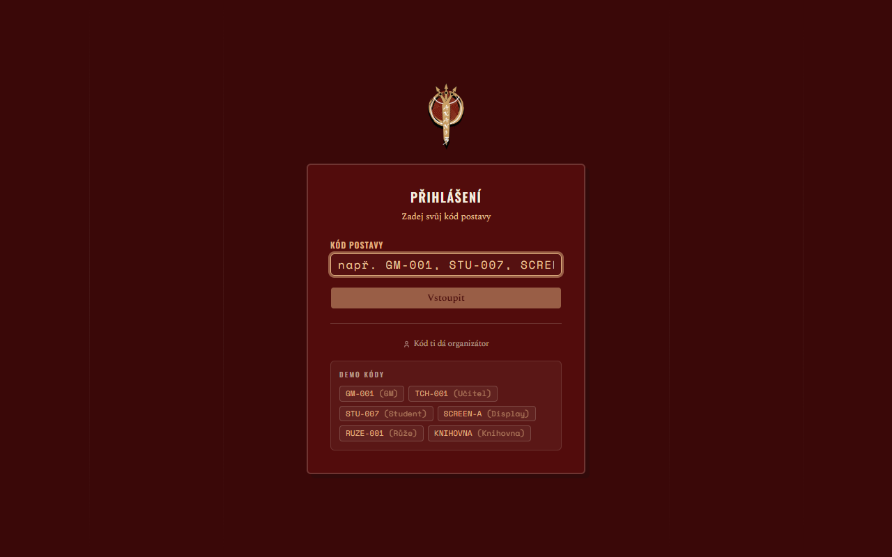

# Akano 3



A companion web app for the LARP *Akano* — runs on players' phones and the organizers' laptop during the game and keeps the shared game state in sync.

**Live:** <https://akano3.vercel.app>

## Features

- **Character login** with a code; each player sees their team, points and level.
- **Points economy** — organizers assign points to characters, teams or whole groups; players can gift points to each other from a limited peer pool.
- **Kaichi levels** and timed **lesson windows** players can claim during the game.
- **Alarms and broadcasts** shown on every device; all clients sync the game state every 2 seconds.
- **QR codes** generated by organizers that award points when scanned.
- **In-game library** — a wiki of lore articles with internal links, search and a force-directed link map (d3-force).
- **Scoreboard, charts and transaction log** for the organizers.
- **Runs** — the same game can be played several times with separate state.

## Stack

Next.js (App Router), React, TypeScript, Tailwind CSS + shadcn/ui, Neon serverless Postgres, Recharts, d3-force. Validation and point-resolution logic is covered by Node unit tests (`lib/*.test.mjs`).

## Running locally

```bash
npm install
# .env.local: DATABASE_URL (Neon Postgres), ADMIN_TOKEN
npm run dev
```

---

🇨🇿 **Česky:** Webová aplikace pro LARP Akano — přihlášení postav kódem, body a dary mezi hráči, kaichi levely, alarmy a hlášení na všech zařízeních, QR kódy, herní knihovna (wiki s mapou odkazů) a přehledy pro organizátory. Next.js + Neon Postgres.
